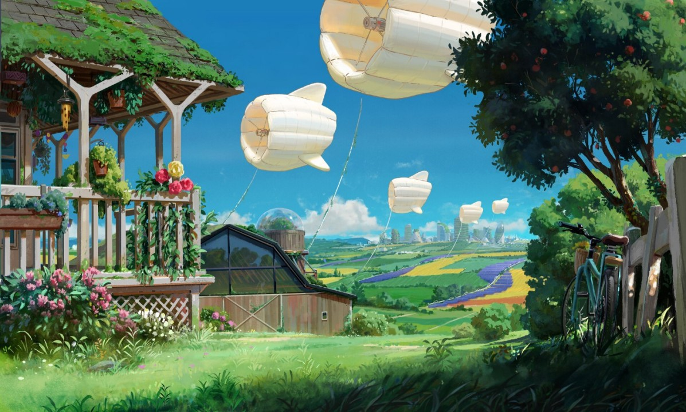
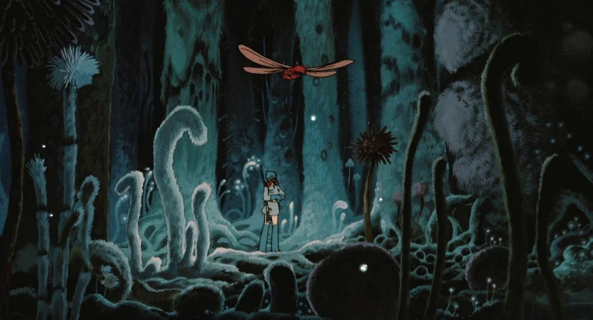
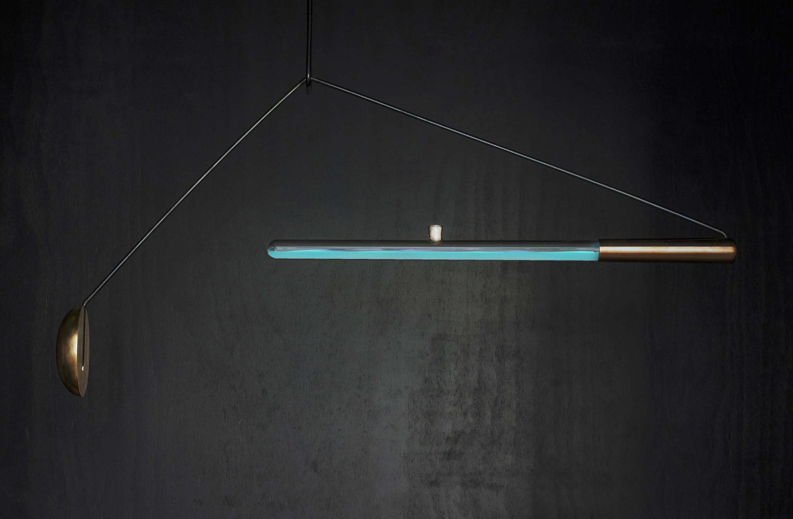

I recently learned about
[lunarpunk](https://aesthetics.fandom.com/wiki/Lunarpunk) and I can't stop
thinking about it. It's solarpunk's nocturnal brethren, cyberpunk's more utopian
twin.

I've always been a fan of [solarpunk](https://re-des.org/a-solarpunk-manifesto/)
ethos and aesthetic. It has this mix of sun-drenched anarchy and verdant
optimism. Sustainability, solar panels, solutions for false scarcity, smart
cities, self-sustaining societies. That's solarpunk. It looks washed out,
contrasting, dominated by greens and blues.

Lunarpunk retains the optimism and glow of solarpunk, but thrives at night. It
swaps sunlight and green gardens for moonlight and bioluminescence. It feels
more introspective and individualistic, more quiet. The aesthetic is still
nature-based but celebrates the lesser seen vibrancy of the night: glowing
purples and teals of mushrooms and bacteria.

Hayao Miyazaki is most known for his richer solarpunk-friendly style, but
Nausicaä of the Valley of the Wind-his first film before founding
Ghibli-explores a lot of this lunarpunk concepts.

A lamp powered by bioluminescent bacteria. A beautiful object by designer Teresa
van Dongen.

Lunarpunk shares a lot of visual common ground with cyberpunk. The etherial glow
against a dark background and individualistic rebellion. Cyberpunk is fascinated
by self-reliance, assembled computers (cyberdecks), and a blurred boundary
between man and machine. Lunarpunk shares the self-reliance, but with a focus on
sustainable balance and a blurred boundary between man and nature. It replaces
cyberpunk's alienation with belonging, domination with decentralization,
survival with sanctuary, dystopia with utopia. Instead of imagining living
covertly within corporate-dominated mile-high neon advertisements, it imagines
living integrated into a decentralized commune with a very-alive nature.
